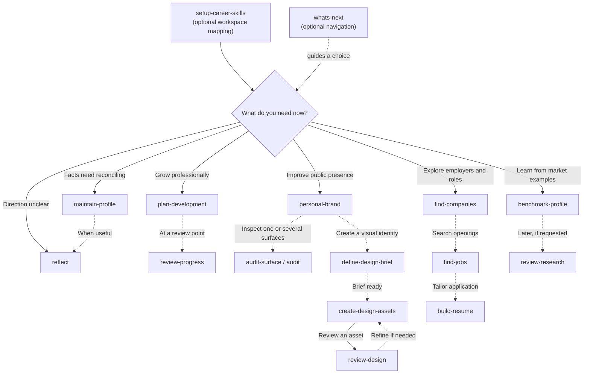

# Career Skills user journey

**Setup is optional; navigation is optional; every leaf skill is independently invocable.** The diagram shows *possible* paths, not execution dependencies or an automated pipeline. Enter any branch directly when the task is already clear.

## Choosing the next step

Solid arrows identify the choice being made. Dashed arrows identify **optional follow-on activities**. None of these arrows implies the next skill must be installed or automatically invoked.

## Suggested first session

1. **`setup-career-skills` (optional):** Map the user's existing records, assets, sources of truth, write permissions and tracker. It doesn't require completing a career interview or migrating files.
2. **`maintain-profile`, when facts need attention:** Reconcile experience, qualifications and project evidence. Skip if existing records are already reliable; users can come back whenever something changes.
3. **`reflect`, when direction is unclear:** Clarify motivations, preferences and trade-offs. Skip if the user has an established direction.
4. **Choose a branch:** Development, branding, job search or market research can proceed independently or concurrently. Skills read the relevant existing evidence and do not require a prescribed predecessor.

## Which workflow fits?

| User wants to... | Skill | Result |
| --- | --- | --- |
| Set up or reconnect existing sources | `setup-career-skills` | Mapped workspace and authority |
| Choose a next task without knowing the skill names | `whats-next` | One next-step recommendation |
| Correct or add career facts | `maintain-profile` | Supported canonical updates |
| Decide where their career should go | `reflect` | Reflection and direction brief |
| Build a growth plan / review one | `plan-development` / `review-progress` | Plan / evidence-based check-in |
| Clarify professional messaging | `personal-brand` | Positioning and reusable wording |
| Design a logo, banner or visuals | `define-design-brief` → `create-design-assets` → `review-design` | Brief, versioned assets, critique (use only needed stages) |
| Audit one profile or compare multiple surfaces | `audit-surface` / `audit` | Surface findings / alignment matrix |
| Research employers or live openings | `find-companies` / `find-jobs` | Target companies / verified roles |
| Create a resume for an opportunity | `build-resume` | Truthful targeted resume |
| Learn from public career examples | `benchmark-profile` | Comparator observations |
| Revisit retained career research | `review-research` | Keep, refresh or guided archive |

## How `whats-next` behaves

Invoke **`whats-next`** explicitly, for example:

- *"I finished setup; what's next?"* → inspect what is known and suggest profile reconciliation or reflection **only when needed**.
- *"My profile is already accurate and I want to apply for jobs."* → recommend `find-jobs`, `find-companies` or `build-resume` depending on the immediate objective.
- *"I have a logo draft but it feels off."* → recommend `review-design`; no new design brief required.
- *"I'm learning .NET architecture; what should I work on?"* → recommend `plan-development` or `review-progress` depending on whether a plan already exists.

The result is a **recommendation**, not a hand-off that executes another skill. Users explicitly select the next skill themselves. Where a client does not support manual-invocation flags, the intended behavior may not be enforced by metadata; see [invocation policy](ARCHITECTURE.md#invocation-policy).

## Workspace, permissions and feedback

The five homes in [WORKSPACE.md](WORKSPACE.md) describe where user records belong, not steps of this journey. A skill can run using pasted documents without setup. Fact records, aspirations, messaging, approved assets and published surfaces remain distinct. Every task follows the user's existing permissions; navigation alone does not alter data or publish anything.
