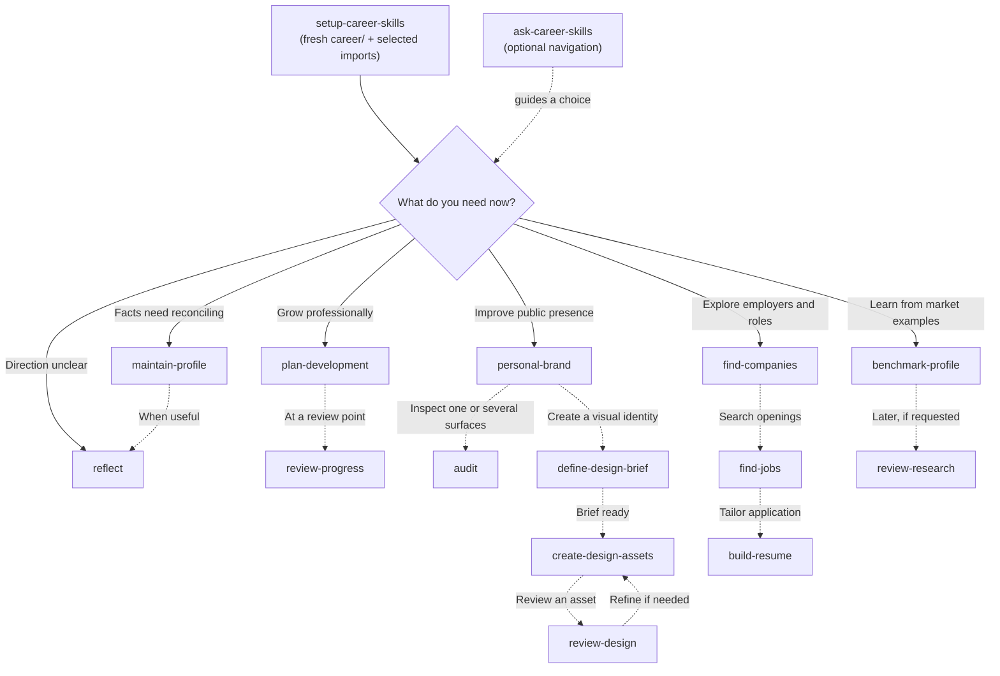
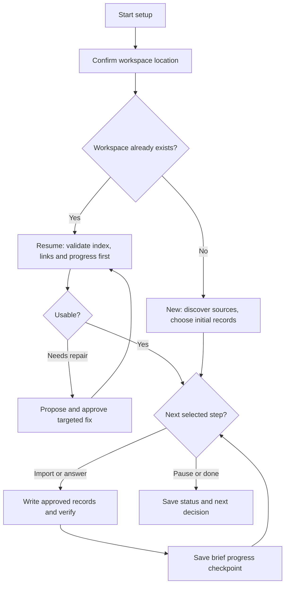

# Career Skills user journey

**Setup is optional; navigation is optional; every leaf skill is independently invocable.** The diagram shows *possible* paths, not execution dependencies or an automated pipeline. Enter any branch directly when the task is already clear.

## Choosing the next step

Solid arrows identify the choice being made. Dashed arrows identify **optional follow-on activities**. None of these arrows implies the next skill must be installed or automatically invoked.

`validate-workspace` remains a separate on-demand structural helper, not a compulsory dependency. Resuming setup includes a **lightweight structural check**; call the helper only if needed and available. Other installed skills may load it when a broken path blocks their task. See the [runtime execution flow](ARCHITECTURE.md#task-execution-flow).

## Guided setup within the first session

The setup skill has **two paths** after the user confirms the destination: create from scratch or validate an existing workspace and resume its saved progress. It stays engaged through user-approved intake steps rather than ending after creating a directory.

For a resume, verify the index, relevant links, canonical records and pending items **before further edits**. `validate-workspace` is optional for structural problems; setup can do its own lightweight checks. Ask the next useful question using known answers; do not require all five homes to contain substantive data. Save missing/deferred work and the next decision in `career/README.md`.

## Suggested first session

1. **`setup-career-skills` (optional):** Confirm the destination, then either create a new workspace from selected sources or **validate the existing workspace before resuming**. Continue one question at a time, save progress and stop when the user agrees. No fixed questionnaire is required.
2. **`maintain-profile`, when facts need attention:** Reconcile experience, qualifications and project evidence. Skip if existing records are already reliable; users can come back whenever something changes.
3. **`reflect`, when direction is unclear:** Clarify motivations, preferences and trade-offs. Skip if the user has an established direction.
4. **Choose a branch:** Development, branding, job search or market research can proceed independently or concurrently. Skills read the relevant existing evidence and do not require a prescribed predecessor.

## Which workflow fits?

| User wants to... | Skill | Result |
| --- | --- | --- |
| Create a common career/ workspace from existing documents | `setup-career-skills` | Standard workspace, source inventory and selected records |
| Align an old directory tree or repair broken links | `validate-workspace` | Migration plan, structural status or scoped repair |
| Choose a next task without knowing the skill names | `ask-career-skills` | One next-step recommendation |
| Correct or add career facts | `maintain-profile` | Supported canonical updates |
| Decide where their career should go | `reflect` | Reflection and direction brief |
| Build a growth plan / review one | `plan-development` / `review-progress` | Plan / evidence-based check-in |
| Clarify professional messaging | `personal-brand` | Positioning and reusable wording |
| Design a logo, banner or visuals | `define-design-brief` → `create-design-assets` → `review-design` | Brief, versioned assets, critique (use only needed stages) |
| Audit one profile or compare multiple surfaces | `audit` | Surface findings, plus alignment matrix for several |
| Research employers or live openings | `find-companies` / `find-jobs` | Target companies / verified roles |
| Create a resume for an opportunity | `build-resume` | Truthful targeted resume |
| Learn from public career examples | `benchmark-profile` | Comparator observations |
| Revisit retained career research | `review-research` | Keep, refresh or guided archive |

## How `ask-career-skills` behaves

Invoke **`ask-career-skills`** explicitly, for example:

- *"I finished setup; what's next?"* → inspect what is known and suggest profile reconciliation or reflection **only when needed**.
- *"My profile is already accurate and I want to apply for jobs."* → recommend `find-jobs`, `find-companies` or `build-resume` depending on the immediate objective.
- *"I have a logo draft but it feels off."* → recommend `review-design`; no new design brief required.
- *"I'm learning .NET architecture; what should I work on?"* → recommend `plan-development` or `review-progress` depending on whether a plan already exists.

The result is a **recommendation**, not a hand-off that executes another skill. Users explicitly select the next skill themselves. Where a client does not support manual-invocation flags, the intended behavior may not be enforced by metadata; see [invocation policy](ARCHITECTURE.md#invocation-policy).

## Workspace, permissions and feedback

The five standardized physical homes in [WORKSPACE.md](WORKSPACE.md) describe where managed career records belong, not mandatory skill execution steps. A skill can run using pasted documents without setup. Fact records, aspirations, messaging, approved assets and published surfaces remain distinct. Every task follows the user's existing permissions; navigation alone does not alter data or publish anything.
