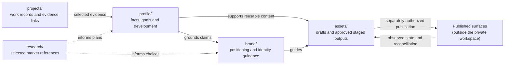

# Career workspace

Use ordinary Markdown and links in user-selected private storage: local files, a Git repository, Drive, OneDrive or another Markdown-capable provider. **For a Career Skills-managed workspace, use one chosen root (conventionally `career/`) with the five homes below.** They are career records, not installable skill categories. A managed workspace uses these five standard home names, creating directories as needed. Task skills also work without a managed workspace.

## Five homes

| Directory | Owns | Related skills |
| --- | --- | --- |
| profile/ | Background, capabilities, aspirations, preferences and development | reflect, maintain-profile, plan-development |
| projects/ | Career-oriented project records and links to actual work | maintain-profile; other skills consume selected project evidence |
| brand/ | Positioning, target surfaces, visual identity (brief, design system, brand tokens) | personal-brand, visual-identity, audit |
| assets/ | Reusable external-facing outputs: copy, visuals and resumes, as drafts and approved staged material | personal-brand, visual-identity, build-resume, audit |
| research/ | User-selected company, opportunity and comparator references; archived research | find-companies, find-jobs |

Profile grounds brand and growth decisions; projects can supply evidence. Brand guides assets. Selected research informs market understanding, targeting, presentation and development. Research about someone else never proves a personal capability. A project is not automatically evidence: link the repository, outcome or feedback supporting a particular claim.

## Logical data flow

The five homes are **standard physical destinations within the chosen managed workspace root**, as well as distinct responsibilities. A folder can remain uncreated until needed. Links describe information flow, not permission to synchronize records automatically.



The profile is authoritative for personal facts and selected intentions, while a published site or account is authoritative **only for what is actually live**. Projects and research can support decisions but do not automatically establish a person's achievements. Brand guidance informs reusable assets; staged assets never establish publication. Corrections propagate to other records or external surfaces only through the user's selected task and permissions.

## Standard managed layout

New managed workspaces use these home names directly under the selected root, usually `career/` but potentially another user-named folder. Create directories and substantive records only when needed by the user's selected work; a workspace index can show pending areas before their folders exist. Individual filenames below are examples, not mandatory templates. A Git repository does not track empty directories, so do not add filler files solely to make all homes visible.

```text
career/
  README.md
  profile/
    experience.md
    education.md
    qualifications.md
    languages.md
    skills.md
    direction.md
    preferences.md
    development.md
  projects/
    project-name.md
  brand/
    positioning.md
    surfaces.md
    identity.md
  assets/
    drafts/
    staged/
  research/
    companies/
    opportunities/
    profiles/
    archive/
```

**Record map.** This is the shared contract for where facts go. Skills that write records carry a verbatim copy (checked by the validator); change it here and in every copy together.

<!-- record-map -->
| Fact | Record |
| --- | --- |
| Name and contact details the user chose to import (name, e-mail, phone, public links) | `profile/contact.md` |
| Employers, titles/grades, dates, internships | `profile/experience.md` |
| Degrees and schools | `profile/education.md` |
| Certifications, licences, awards | `profile/qualifications.md` |
| Skills and tools | `profile/skills.md` |
| Spoken languages | `profile/languages.md` |
| Goals, north star, considered next steps | `profile/direction.md` |
| Location, work mode, commute, contract, salary preferences | `profile/preferences.md` |
| Client assignments, side projects, contributions and their outcomes | `projects/<project>.md`, linked from the role in `experience.md` |
| Positioning, bios, visual guidance | `brand/` (only when the source contains it) |
| Public surfaces to target (URL, audience, purpose, emphasis) | `brand/surfaces.md` |
| Reusable resumes, bios, banners | `assets/drafts/` or `assets/staged/` (approved) |
| Saved companies, job ads, comparator profiles | `research/` |
<!-- /record-map -->

Unused homes can remain documented in `career/README.md` until populated. Create only needed records; combine or split files when useful. direction.md can hold north star, values, motivations, interests and goals. development.md holds actions, evidence milestones and dated progress reviews. Project records describe purpose, status, contribution, skills used, learning, relevance to a resume and links to work; do not copy source code or the project's backlog.

## Brand tokens

<!-- brand-tokens -->
Resume and document styling reads one fenced block in `brand/identity.md`. `visual-identity` writes it; `build-resume` reads it. One `key: value` per line; omit keys you have not decided.

```brand-tokens
status: approved          # approved | pending; pending tokens are not applied without the user's say-so
primary: #0F766E          # headings and section bars (contrast >= 3:1 on white)
accent: #B45309           # headline and highlights (contrast >= 3:1 on white)
text: #1F2937             # body text (contrast >= 4.5:1 on white)
muted: #4B5563            # dates, locations, secondary text (contrast >= 4.5:1 on white)
heading-font: Manrope     # installed font family name; licence link in prose below the block
body-font: Source Sans 3
```

Colours are `#RRGGBB`. Write the block with `status: pending` while concepts are drafts and switch to `approved` only when the user approves the palette and fonts. Values that fail the format or contrast rule are ignored with a warning, and the neutral default is used.
<!-- /brand-tokens -->

brand/ contains guidance, not a second asset library. identity.md can describe fonts, palette, logo and composition rules, linking actual sources under assets/. Design interview answers can live in brand/discovery.md. **Legacy source filenames** such as `goals.md` or `certifications.md` can inform the new records; don't rename or import a file solely because its name looks similar.

## Initialize from existing sources

`setup-career-skills` is the entry point when the user wants a **managed** career workspace. Confirm the **exact workspace root** before inspecting or creating files. A user-named folder is the root itself; when the user specifies a repository as the parent, propose its `career/` folder. Never silently choose the current repository, add a nested `career/`, or create an empty folder as a standalone onboarding result. After choosing the destination, distinguish **new creation** (empty target) from **resumption** (existing workspace). For resumption, validate the index, mapped files/links, canonical ownership and saved progress **before continuing imports**. Reuse the confirmed location and previous decisions rather than restarting the interview.

1. **Confirm destination and mode.** Ask where the workspace belongs (unless already specified or confirmed). Inspect the selected location only. If an existing workspace is present, **validate before any changes**; repair broken mappings only with approval, then resume saved pending work. Otherwise start fresh. Ambiguous occupied directories require the user's decision; don't overwrite or create a duplicate root.
2. **Discover (read-only).** With permission, look for existing career notes, resumes, portfolio/project documents, certificates, published profile exports and other user-supplied sources. Record where they are and what each might contribute; ask before expanding access or reading sensitive material.
3. **Select and map.** Present a concise inventory and recommend which sources/sections to bring in first. Let the user choose. Map selected claims to `profile/`, project records to `projects/`, positioning and design guidance to `brand/`, reusable artifacts to `assets/`, and selected outside references to `research/`. External documents are **inputs**, not automatically authoritative workspace files.
4. **Create the canonical destination.** After confirming storage and write policy, initialize `README.md` at the selected root plus the standard homes needed for selected content, documenting unused homes as pending without creating empty folders. Extract selected content into canonical Markdown records; **do not bulk-copy old workspaces or invent filler data**. Treat `profile/experience.md` as a complete *role-history* record for the chosen sources (including internships where supported), not a dump of client engagements; place assignments and project evidence in `projects/` with links. Retain source locations, dates when known and uncertainty; ask about real contradictions or omissions.
5. **Review gaps and continue.** Check new records and links, and list what is captured, missing, uncertain and intentionally deferred. Ask the next most useful question, including about unconsidered existing documents and essential facts absent from selected sources; don't stop after the first import batch. Save a short `in progress` / `paused` / `ready` / `blocked` checkpoint with the selected next area in the root `README.md`. Finish guided onboarding only when the user confirms the chosen scope is sufficient or chooses minimal setup. No fixed questionnaire or fully populated five-home requirement.

**Chosen root already occupied?** Resume the existing workspace after lightweight validation, or let the user choose a different root. If they explicitly request a physical migration, propose a plan before moving anything; `validate-workspace` is optional. Never overwrite the existing root, create a hidden duplicate authority, or move/delete old files without a selected migration plan and approval. Import can also be read-only when no write destination is available.

## Adopt and migrate an existing career tree

If the user requests **physical alignment**, compare their current tree with the standard root. For example, `career/personal-projects/` may map to `career/projects/`, `career/personal-brand/` to `career/brand/` and `career/services.md` (a list of public profiles) to `career/brand/surfaces.md`. These are **candidate changes**, never automatic renames.

For a selected migration, inventory affected files, collisions, inbound/outbound links **across the accessible repository** and source ownership. A condensed import is not automatically a lossless replacement: preserve source evidence and links needed by the new records. Produce a proposed path map, preserve Git history where practical, update references and verify both workspace links and links from elsewhere after approved writes; explicitly report inaccessible scope. Keep any unsupported or conflicting data in its original source until the user decides. Changes to factual content or public platforms are separate tasks.

An existing custom layout can remain **operational** through its index even before migration. When the user explicitly asks to assess standardization, report deviations and a migration proposal; during an unrelated skill's task, correct only concrete broken paths. Physical alignment is the default destination for new managed work, not a prerequisite for using individual skills.

## Assets and services

- drafts/ contains proposed text and visual work; staged/ contains the latest explicitly approved reusable versions. Neither proves publication. Preserve meaningful option/revision history without a mandatory final/ directory.
- Organize by content/use (bios, headlines, resumes, logos, banners) only when needed. Reuse a shared bio or headline across surfaces; create separate adaptations only for intentional differences. Link rather than duplicate common content or visual masters.
- brand/surfaces.md (owned by personal-brand) lists each public presence tied to the profile: URL, audience, why it is targeted, what to emphasise, linked copy, status and last-reviewed date. `audit` reads it. A legacy `assets/services.md` is a source to import. Do not assume APIs, scraping or automation work.
- Live surfaces establish actual published state; the profile establishes supported personal facts and intentions. Source code can help inspect a website but does not prove what is deployed. A staged asset is not a published snapshot.
- Compare accessible live content, or user-provided exports/pasted text, with the relevant staged material. State source and inspection date/limits; do not require a historical snapshot store. If there is a difference, ask whether to update the workspace, the external surface or leave an intentional adaptation. Do not guess which side changed.
- Flag factual incoherence before importing public edits into the profile. Importing wording does not establish the truth of a new credential, role or achievement. Publication requires the user's authorization; manually copying staged material is a valid workflow.

## Research selection and retention

- Present a shortlist first; the user may save some, all or none, or supply references directly. An explicit instruction to save a defined set also authorizes retention. Do not save every discovered result automatically.
- Keep one useful record per selected company, opportunity or comparator; link an opportunity to its company rather than duplicating the company description. profiles/ includes professional profiles, portfolios and resume references; a comparison across several may be a linked summary.
- Save sources, checked dates, useful findings, why the user retained the reference, relevance/fit, unknowns and next decisions as applicable. Store links to other people's resumes, not copied resume files. Keep only useful observations, not every query, page or intermediate thought.
- Research is a long-term reference library. An expired job may still explain market requirements; an older profile can remain useful inspiration. Age alone does not make a record disposable.
- Research review runs on request. Prefer archiving under user guidance, retaining useful history and updating affected links. Deletion is manual. During unrelated work, an agent noticing stale content asks whether the user wants it reviewed; it does not silently archive, delete or start background maintenance.

## Workspace index and record rules

Use the chosen root's `README.md` (typically `career/README.md`) as the managed workspace entry point: record storage location, source and ownership map, relevant original sources (imported, pending, excluded), optional tracker, branch/PR workflow, read/write boundaries, external publication permissions and unresolved decisions. Link rather than duplicate supporting documents; never store credentials in it.

For an existing workspace, map before migrating. Legacy files may remain source documents until approved extraction or relocation. A folder's name never proves what a file contains; inspect the material needed for the user's selected scope. Ask only relevant missing decisions.

Use readable headings and relative links; no mandatory YAML, IDs or database. Separate facts, user preferences, interpretations and aspirations. Retain source/date and current/planned/superseded status where material. Decisions include rationale; actions include next steps and evidence/review points. Preserve uncertainty and meaningful history.

Before editing, read current canonical records and preserve unrelated changes. Use available version/conflict controls and the chosen write workflow. Confirm saves and links; when writes are unavailable, provide a proposed patch without claiming success. Skills remain useful from pasted input or selected files without an index, another skill or a specific provider.

## Minimal workspace index

Keep the first `career/README.md` small. For example, adapt these fields without introducing a required schema:

```markdown
# Career workspace
Storage: private local folder or repository
Write policy: propose changes / approved direct edits / pull requests
Canonical areas: profile/, projects/, brand/, assets/, research/

## Source inventory
| Existing source | Decision | Managed destination | Notes |
| --- | --- | --- | --- |
| Path or user-provided link | imported / pending / excluded | profile/experience.md (if selected) | source date, unresolved differences |

## Boundaries
Publication: separate approval required
Unresolved mappings: list only actual blockers
```

Include only source references needed to support future work. The index links records; facts imported from sources go into the canonical records, never into the index. The index must not contain passwords, private file contents, or a dump of every discovered document. Update source-import status when selected content has actually been written and verified.

**Index contract shared by all skills.** Every path in the index is relative to the workspace root (a source beside the root is `../old-notes/resume.md`). Section ownership:

- `Records`: any skill that creates a canonical record adds one link here.
- `Source inventory`: updated by whichever skill imports a source (normally setup or `maintain-profile`).
- `Setup progress`: owned by `setup-career-skills`. Other skills leave it untouched and report their own next steps in their reply or their own record.

For guided onboarding, add a brief **Setup progress** entry: status (`in progress`, `ready`, `paused`, `blocked`), covered areas, missing/conflicting or deferred items, and the specific next user decision. The initial scaffold and first import batch are not by themselves proof that the onboarding conversation is complete.

## On-demand workspace validation

`validate-workspace` is the structural exception handler for a failed mapped path, broken link or competing canonical record, and it also handles **explicit workspace-structure reviews**. During another task it checks only the blocker; during a requested review it checks the existing workspace index, mapped records and relevant links. Custom legacy folder names with working index mappings are operational, and intentionally uncreated areas or pasted inputs need no repair during normal tasks. When specifically asked to check alignment with the managed standard, report deviations and propose a scoped migration, without treating them as automatically broken links.

**Repair rule.** Shared by `validate-workspace` and `setup-career-skills` (verbatim copies, validator-checked):

<!-- repair-rule -->
1. A request to check, review or resume is read-only for structure: report the status and the proposed fix, then ask before changing files.
2. A link to a renamed or moved record: update the link and the index entry; the user's file name and location win.
3. Rename or move a record to its standard name only when the user explicitly asks to standardize the layout.
<!-- /repair-rule -->

Initial configuration remains `setup-career-skills`' responsibility. Prefer repairing a mapping or link to moving records. A narrow index fix needs task-specific write authorization; a move, merge, rename or deletion requires an explicit plan and approval. The validator returns a structural status and usable path (or blocker) to the original workflow. Its availability and invocation depend on the host; every task skill remains independently usable.

## Skill contracts and paths

Each SKILL.md defines a concise Input / Scope / Output contract: required records or supplied material, the responsibility boundary, and the destination/result. Contract paths are relative to the standardized `career/` workspace root for managed work. Existing source documents and legacy workspaces can still be mapped by the index; these are not skill installation paths. Without a workspace, work from supplied inputs and clarify only missing authority or destination decisions needed for the task.

Keep workspace-wide structure and lifecycle rules here. Skill contracts name only their own inputs and outputs; they do not repeat all five homes, storage-provider instructions or unrelated lifecycle rules. A skill remains independently usable from its task-specific contract and workflow; no runtime schema, mandatory setup skill or full-workspace read is required.
